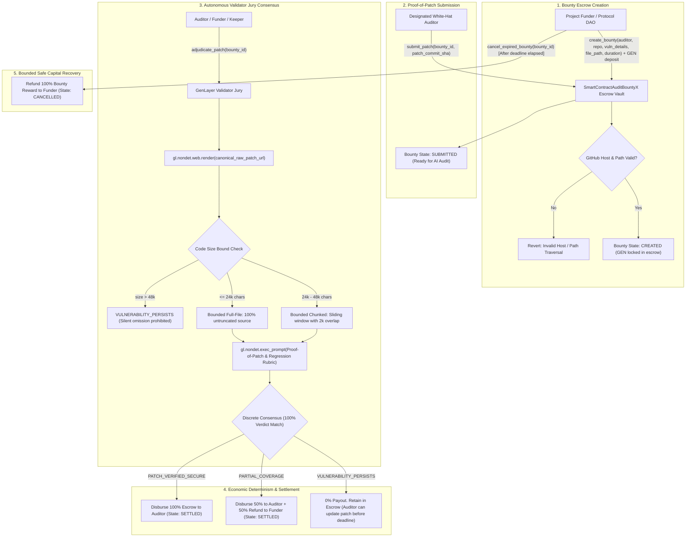

# SmartContractAuditBountyX — Autonomous Vulnerability Fix & Proof-of-Patch Escrow Protocol

> **Track:** Autonomous Protocols / Future of Work  
> **Network:** GenLayer studionet (Chain ID: `61999` / `0xF1EF`)  
> **Target Environment:** [GenLayer Studio](https://studio.genlayer.com)  
> **Execution Engine:** GenVM / Optimistic Democracy Semantic Consensus  
> **Contract Source:** [`contracts/smart_contract_audit_bounty_x.py`](contracts/smart_contract_audit_bounty_x.py)  

---

## 1. Live Deployment & Verification

The **SmartContractAuditBountyX** Intelligent Contract is deployed, finalized, and verified on GenLayer **studionet**:

- **CONTRACT_ADDRESS:** `0xdf7Dc08993611E2A28C0DDA82a2a7F6A6b82a878`
- **TRANSACTION_HASH:** `0x6a1b96983639720bd51209429f2afef7d300f27c66bc8930c9bf85b42221153e`
- **DEPLOYER_ADDRESS:** `0x778cEde2FCbe3e5Bc0ccA7D32bb99Fd01cD8f8Ec`
- **NETWORK:** `studionet` (Chain ID: `61999` / `0xF1EF`)
- **RPC_URL:** `https://studio.genlayer.com/api`
- **RECEIPT_STATUS:** `5` (FINALIZED)
- **RESULT:** `6` (SUCCESS)
- **Deployment Details:** [`deployment.json`](deployment.json)

---

## 2. Core Problem & The 1-Line Pitch

### The Core Problem
In the Web3 security ecosystem, smart contract vulnerability remediation and bug bounty programs (e.g. Immunefi, HackerOne, manual audit firm retainers) suffer from critical friction:
1. **Centralized Escrow & Trust Asymmetry:** White-hat auditors discover critical vulnerabilities (reentrancy, logic bypasses, flash-loan vulnerabilities), but must disclose details to protocol developers before receiving payment. Project teams often downplay severity, claim duplicate findings, or stall payouts indefinitely.
2. **Off-Chain Discretion & Subjective Bias:** Triage and proof-of-patch validation are controlled by a single internal developer or central review committee, with zero deterministic guarantee that an auditor who writes a flawless patch will actually be compensated.
3. **Legacy Blockchain Blindness:** Solidity and EVM contracts cannot access the web or read raw source code repositories (e.g., GitHub raw files or commit diffs). They cannot inspect code modifications, verify whether an exploit vector has been closed, or arbitrate proof-of-patch escrow agreements.

### Why This Primitive DIES Without GenLayer (The 1-Line Pitch)
> *"Legacy blockchains cannot inspect source code repositories or semantically verify whether a security patch neutralizes a vulnerability; without GenLayer's native non-deterministic web rendering (`gl.nondet.web.render`) and LLM validator jury consensus (`gl.vm.run_nondet`), an autonomous, trustless Proof-of-Patch escrow protocol is fundamentally impossible."*

---

## 3. Architecture & System Flow



---

## 4. Key Protocol Innovations

### 1. Bounded Full-File & Chunked Adjudication (No Silent Omission)
Unlike naive implementations that truncate source code using a fixed prefix (e.g. `[:4000]`), **SmartContractAuditBountyX** strictly implements a **Bounded Full-File & Chunked Strategy** that prevents material code or regressions from being silently excluded:
- **Bounded Full-File Analysis ($\le 24,000$ chars / $\approx 600-800$ Solidity lines):** 100% of the complete target file is passed in full to the LLM validator jury with zero truncation. Validators evaluate both the primary vulnerability mitigation and scan the entire file for side-effect bugs or newly introduced regressions.
- **Bounded Chunked Analysis ($24,000 - 48,000$ chars):** The contract segments the code into sliding window chunks of $20,000$ characters with a $2,000$-character overlap across boundaries. Every chunk is audited; if any chunk retains the vulnerability or introduces a regression, the adjudication evaluates to `VULNERABILITY_PERSISTS`.
- **Anti-Silent-Exclusion Guarantee ($> 48,000$ chars):** If a target file exceeds the upper bounded capacity, the contract fails closed (`VULNERABILITY_PERSISTS`) with an explicit reason, refusing to silently truncate code and allowing unreviewed regressions to slip through.

### 2. Canonical GitHub Host & Raw Binding
The contract never accepts arbitrary, spoofed web URLs from users. Instead:
- It enforces authoritative `github.com` repositories via `_parse_canonical_repo`.
- It sanitizes paths to prevent directory traversal attacks (`_clean_path`, rejecting `..` and `./`).
- Validators independently construct and scrape the authoritative raw source endpoint:
  ```
  https://raw.githubusercontent.com/<owner>/<repo>/<commit_sha>/<target_file_path>
  ```
- This guarantees validators inspect the authentic code at the exact immutable Git commit SHA.

### 3. 100% Discrete Consensus Binding
Standard LLMs produce slight variations in natural-language reasoning. **SmartContractAuditBountyX** prevents validator divergence while retaining explainability by enforcing **discrete semantic equivalence** inside `validator_fn`:

```python
def validator_fn(leader_res) -> bool:
    if not isinstance(leader_res, gl.vm.Return):
        return False
    leader = leader_res.calldata
    ...
    mine = leader_fn()
    # DISCRETE EQUIVALENCE: 100% agreement on exact security verdict
    return leader["verdict"] == mine["verdict"]
```

### 4. Economic Determinism & Payout Matrix

| Security Verdict | Adjudication Condition | Financial Disbursement |
|---|---|---|
| `PATCH_VERIFIED_SECURE` | The patch completely mitigates the vulnerability (e.g., reentrancy guards, checks-effects-interactions, proper access control) without introducing regressions anywhere in the file. | **100% Bounty Reward Disbursed to Auditor**. Bounty state transitions to `SETTLED`. |
| `PARTIAL_COVERAGE` | The patch addresses part of the attack surface but leaves open edge cases or incomplete mitigation. | **50% Disbursed to Auditor, 50% Refunded to Funder**. Bounty state transitions to `SETTLED`. |
| `VULNERABILITY_PERSISTS` | The vulnerability is still exploitable, regressions are detected, the file is unchanged, the fix is cosmetic, or the file returns 404/offline/exceeds bound. | **0% Disbursed**. Bounty remains `SUBMITTED`, giving the auditor opportunity to submit an updated commit SHA before the deadline. |

### 5. Bounded Recovery Path (Anti-Capital Trap)
If an auditor abandons the bounty, misses the agreed deadline, or fails to provide a passing patch, the project funder is protected against locked capital:
- Calling `cancel_expired_bounty(bounty_id)` after `deadline` has elapsed immediately refunds **100% of escrowed funds** back to the funder and marks the bounty `CANCELLED`.
- Premature cancellation during the active bounty window is strictly prevented on-chain.

---

## 5. Contract API Reference

### State Storage
- `owner: Address`: Contract deployer and administrative address.
- `bounty_count: bigint`: Sequential counter of audit bounties created.
- `bounties: TreeMap[str, AuditBounty]`: Persistent storage map of all audit bounty escrows keyed by `bounty_id`.

### Public Write Methods
- `create_bounty(auditor: Address, repo_url: str, vulnerability_details: str, target_file_path: str, duration_sec: int) -> str`:  
  *Payable*. Funder locks GEN into escrow bound to a target repository, vulnerability description, and designated auditor.
- `submit_patch(bounty_id: str, patch_commit_sha: str) -> None`:  
  Auditor submits the Git commit hash containing the proposed security fix.
- `adjudicate_patch(bounty_id: str) -> None`:  
  Triggers non-deterministic GitHub raw code scraping, LLM security jury evaluation, discrete consensus, and automated payout.
- `cancel_expired_bounty(bounty_id: str) -> None`:  
  Allows funder to reclaim 100% of escrowed funds if the deadline has elapsed without a verified settlement.

### Public View Methods
- `get_bounty(bounty_id: str) -> str`: Returns full JSON string of the bounty state record.
- `get_bounty_count() -> int`: Returns the total number of bounties created.
- `get_current_time() -> int`: Returns current execution timestamp.
- `get_owner() -> str`: Returns hex string of contract owner.

---

## 6. Test Suite & Verification

The project includes full unit test coverage using `gltest` (**12/12 passed**):

```bash
gltest
```

### Test Coverage Summary:
- **`test_initial_state`**: Verifies owner initialization, initial bounty count, and execution time.
- **`test_create_bounty_success`**: Verifies payable escrow locking, canonical repo parsing, and state assignment.
- **`test_create_bounty_validations`**: Verifies zero deposit rejection, self-auditor rejection, short vulnerability description validation, invalid GitHub host rejection, invalid repo URL rejection, and path traversal prevention (`../` and `./`).
- **`test_submit_patch_flow`**: Tests non-existent bounty check, unauthorized sender rejection, short commit SHA validation, and successful patch submission.
- **`test_adjudicate_patch_verified_secure_100_percent_payout`**: Simulates complete security patch verification, 100% auditor payout, and transition to `SETTLED`.
- **`test_adjudicate_patch_partial_coverage_50_percent_payout`**: Simulates partial fix, 50/50 split disbursement, and transition to `SETTLED`.
- **`test_adjudicate_patch_vulnerability_persists_resubmission`**: Simulates failing patch evaluation, 0 payout, maintaining `SUBMITTED` state, and auditor re-submission of updated commit SHA.
- **`test_adjudicate_patch_github_offline_or_404`**: Simulates GitHub 404/offline response handling, defaulting safely to `VULNERABILITY_PERSISTS`.
- **`test_cancel_expired_bounty_bounded_recovery`**: Tests non-funder cancellation rejection, premature cancellation rejection, successful post-deadline 100% funder refund, double-cancellation prevention, and post-cancellation patch rejection.
- **`test_adjudicate_patch_evaluates_code_beyond_4000_chars_full_file`**: Verifies that contracts $>4,000$ characters are evaluated in full without silent truncation and verified secure when the fix is past line 140.
- **`test_adjudicate_patch_detects_regression_beyond_4000_chars`**: Verifies that new regressions located past character 4,500 (e.g. Unprotected delegatecall backdoors) are actively flagged and block payouts.
- **`test_adjudicate_patch_exceeding_max_bounded_file_size_fails_closed`**: Verifies that files exceeding bounded limits fail closed with an explicit error rather than silently truncating.

---

## 7. Deployment Guide (GenLayer Studionet)

### Prerequisites
- Python 3.11+
- Install dependencies:
  ```bash
  pip install -r requirements-dev.txt
  ```

### Deploy via Script
To deploy the contract to GenLayer Studionet (`https://studio.genlayer.com/api`):

```bash
python scripts/deploy_studionet.py
```

The script will automatically fund a deployer account, deploy the bytecode, wait for finality, and record the verified deployment receipt in `deployment.json`.

---

## 8. License

MIT License. Designed and developed for the GenLayer Builder Program.
